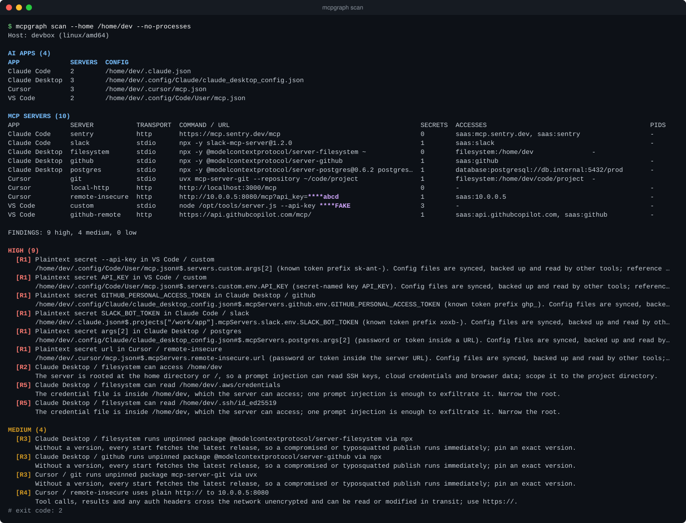
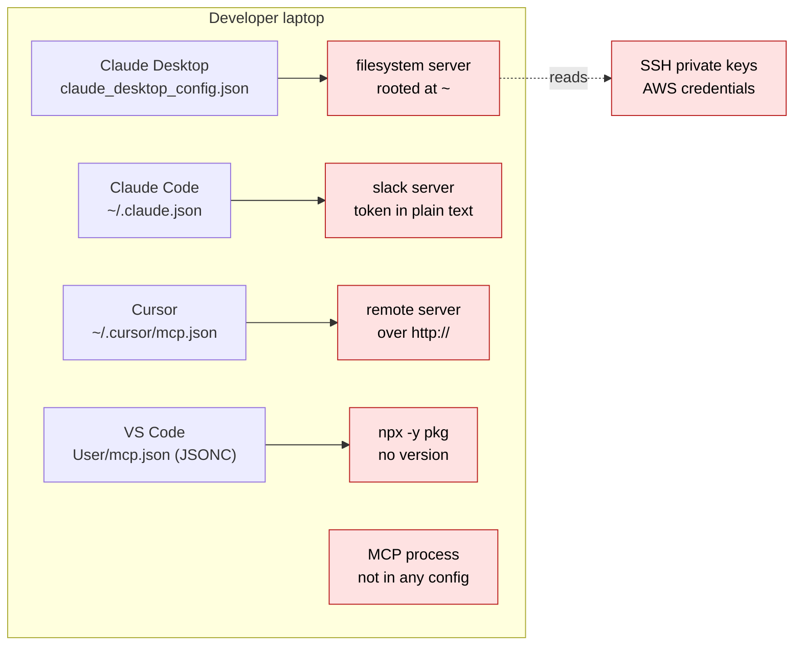
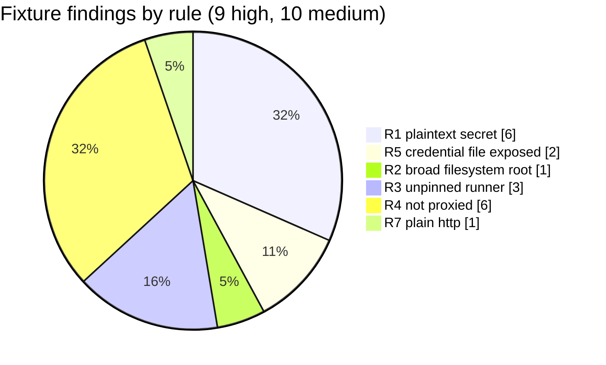
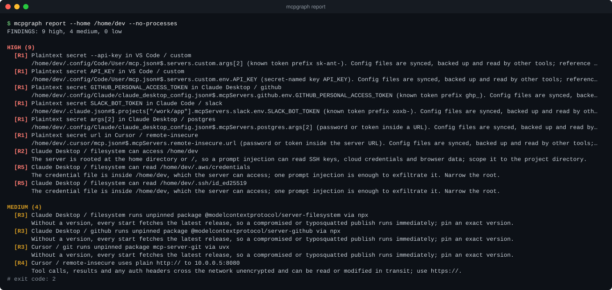
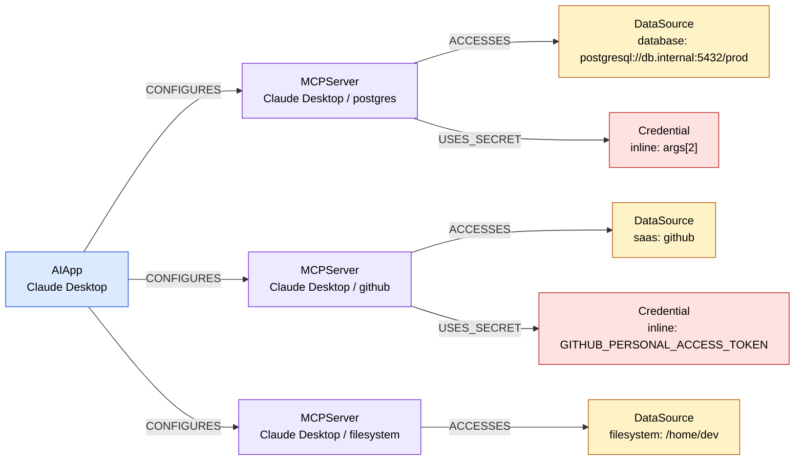
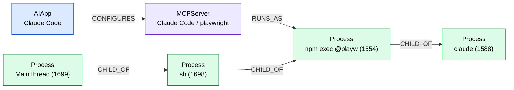
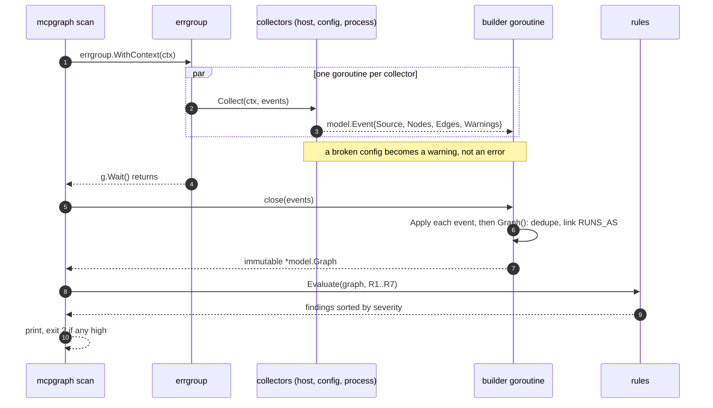
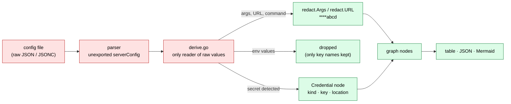
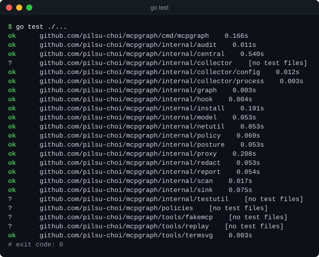
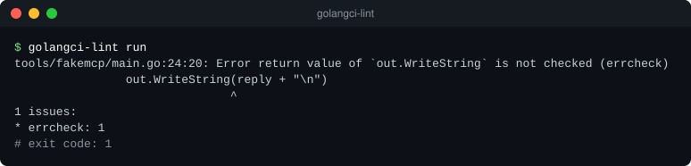

# mcpgraph

[](https://github.com/pilsu-choi/mcpgraph/actions/workflows/ci.yml)


A tiny EDR for AI agents, written in Go. One binary, two jobs:

1. **Visibility (posture).** Which AI apps are installed, which MCP servers do they use, and which
   processes, credentials and data sources can those servers reach? *(done)*
2. **Runtime control.** Catch what an agent is about to do (an MCP tool call, a shell command from a
   coding agent), check it against a policy, and **allow, deny or ask** before it runs. Every
   decision goes to an audit log and into the graph. *(in progress, see [Roadmap](#roadmap))*

> The goal: Claude Code is asked to "clean up the database" and tries `DROP TABLE users`. The policy
> rule `block-destructive-sql` matches, the command never runs, the agent is told why, and the
> decision shows up in the audit log and the graph.

<p align="center">
  
</p>

<sub>The capture above is real `mcpgraph scan` output against the fixtures in <code>testdata/configs</code>.
All secrets there are fake, and they appear masked (<code>****abcd</code>). Every image and log in
<code>docs/</code> is regenerated by <code>make docs</code>.</sub>

## Contents

- [The problem](#the-problem)
- [Quick start](#quick-start)
- [What it finds](#what-it-finds)
- [Architecture](#architecture)
- [Design decisions](#design-decisions)
- [Roadmap](#roadmap)
- [Testing and quality gates](#testing-and-quality-gates)
- [Run logs](#run-logs)
- [Limitations](#limitations) · [Future work](#future-work)

## The problem

AI coding tools (Claude Desktop, Claude Code, Cursor, VS Code) now launch
[MCP](https://modelcontextprotocol.io) servers. These are small programs that give the model tools
such as "read files", "query Postgres" or "post to Slack". Each app keeps its own config file in its
own format and location, so on a typical laptop nobody has the full picture:



- API tokens are pasted in plain text into JSON config files that get synced and backed up.
- A filesystem server is given `~`, which includes `~/.ssh` and `~/.aws`, so one prompt injection can read them.
- `npx -y some-mcp-server` downloads and runs the latest publish on every start.
- Some MCP processes run without being declared in any config at all.

mcpgraph puts all of this into one graph and runs risk rules on it.

## Quick start

```sh
make build                     # CGO_ENABLED=0 go build ./cmd/...
./mcpgraph scan                # inventory + findings; exit code 2 if any finding is high
./mcpgraph report -f json      # findings only, for CI
./mcpgraph export -f mermaid   # graph as a Mermaid flowchart
make docs                      # regenerate docs/logs and docs/images from real runs
```

Useful flags: `--home DIR` scans another home directory (for example the fixtures), and
`--no-processes` skips process discovery.

## What it finds

### Rules

| ID | Detects | Severity | Why it matters |
| --- | --- | --- | --- |
| R1 | Plaintext secret in an MCP server's env, args, headers or URL | high | Config files are synced, backed up and read by other tools |
| R2 | Filesystem MCP server rooted at `$HOME` or `/` | high | One prompt injection can read SSH keys and cloud credentials |
| R3 | Unpinned package runner (`npx -y pkg`, `uvx pkg`, `pkg@latest`) | medium | A compromised publish runs on the next start |
| R4 | stdio MCP server not routed through the mcpgraph proxy | medium | Its tool calls skip the policy check and the audit log |
| R5 | Credential files (`~/.aws/credentials`, `~/.ssh/id_*`, `.env`, ...) inside a path an MCP server can access | high | Names the exact files that are exposed |
| R6 | MCP-like process not declared in any config (shadow server) | medium | Its tools and permissions are invisible to review |
| R7 | Remote MCP over plain `http://` to a non-loopback host | medium | Tool calls and auth headers travel unencrypted |

R7 was R4 in the first version. R4 now means "not behind the proxy", and the plain-HTTP check kept
its logic under a new ID. Until the proxy and `mcpgraph install` exist (milestones 7–8), R4 fires for
every stdio server.

`scan` and `report` exit with code **2** when any finding is high, so they can gate a CI job.

Findings on the fixture home, by rule:



<p align="center">
  
</p>

### The graph

This is the Claude Desktop part of the fixture graph, exported with `mcpgraph export -f mermaid`
(the full export is in [`docs/logs/04-export-fixtures-mermaid.log`](docs/logs/04-export-fixtures-mermaid.log)):



And from a real machine, where Claude Code runs a Playwright MCP server. Process discovery links the
declared server to the running `npm exec` process and follows its children:



## Architecture


| Package | Role |
| --- | --- |
| `internal/model` | Node, Edge, Graph, Event, Finding types; stable node IDs |
| `internal/collector/config` | One parser per app, candidate paths, derivation of credentials and data sources |
| `internal/collector/process` | AI app processes, their children and MCP-like processes |
| `internal/graph` | Single-writer builder, RUNS_AS linking, snapshot diff |
| `internal/redact` | Secret detection and masking |
| `internal/posture` | Posture rules R1–R7, one file each |
| `internal/report` | Inventory and findings tables, JSON, Mermaid |
| `internal/sink` | `Sink` interface for a future central server; only a no-op exists |
| `tools/termsvg` | Renders terminal output as the SVG captures in this README |

### Graph model


<sub>* redacted before the node is created</sub>

### One scan, step by step



## Design decisions

**Single writer.** Only the graph builder goroutine changes graph state. Collectors never touch the
graph; they send `Event`s over a channel. So the graph needs no mutex, and there is no lock ordering
to get wrong. Each event carries a `Source` (for example `config:/home/u/.cursor/mcp.json`), and a
new event from that source replaces everything it sent before. This is how a re-scan of one config
file can remove a deleted server without rebuilding the rest of the graph. Readers only see
finished graphs: the builder publishes a new `*Graph` that shares no memory with its own state
(`Graph.Snapshot()` is a deep copy).

**Context everywhere.** There is one root `context.Context`, cancelled on Ctrl-C or SIGTERM.
Collectors run under `errgroup.WithContext`, so one failing component cancels the others. Every
channel send `select`s on `ctx.Done()`, so nothing blocks forever after shutdown. Partial failures
are not fatal: a broken config file or an unreadable process table becomes a warning on the event,
not an error.

**Collectors are interfaces.** `collector.Collector` has two methods (`Name`, `Collect`). Inside the
config collector, each app is a `parser` with `App()` and `Parse()`. To add an app, you add a parser
file, a line in `paths.go` and a fixture.

**Stable node IDs.** `ID = kind + ":" + sha256(stable key)[:12]`. The key is:

- config path + JSON path for servers,
- location for credentials,
- pid + start time for processes.

The same server has the same ID in every scan. That makes `graph.Diff` a comparison by ID, which is
what will let drift alerts say `new MCP server "notion" added to Cursor config`.

**Secrets are dropped at the edge.**



The raw parsed config type is unexported, so it cannot leave the config package. Masking happens
once, at collection time, so every output is safe by construction. `internal/scan/leak_test.go`
runs the fixtures through every output format and fails if any fake secret appears. `make docs` checks the generated logs and images the same way.

**Read-only, no network.** Scanning never writes outside mcpgraph's own data directory and makes no
outbound connections. Once milestone 8 lands, `mcpgraph install` / `uninstall` will be the only
commands that edit AI-app configs, with backups, a printed diff and `--yes`.

**No cgo.** gopsutil is pure Go. `CGO_ENABLED=0` builds static binaries
for darwin/linux × amd64/arm64.

## Testing and quality gates

```sh
make build    # CGO_ENABLED=0 go build ./cmd/...
make test     # go test -race ./... (without -race if no C compiler is installed)
make bench    # policy engine benchmarks
make lint     # golangci-lint run
make scan     # go run ./cmd/mcpgraph scan
make release  # goreleaser build --snapshot --clean
make docs     # regenerate docs/logs and docs/images
make demo     # the DROP TABLE demo (milestone 10)
```

Tests never read the real machine. They build a fake `$HOME` in `t.TempDir()` from
`testdata/configs`, and the process collector is tested through a fake `Lister`.

| What | Test |
| --- | --- |
| No secret in any output (table, JSON, Mermaid, findings, diff) | `internal/scan/leak_test.go`, `cmd/mcpgraph/main_test.go` |
| Every posture rule: positive and negative cases | `internal/posture/r*_test.go` |
| Concurrent producers, single writer (run with `-race`) | `internal/graph/builder_test.go` |
| A `mcpgraph proxy -- ...` entry is recognised as proxied | `internal/collector/config/proxied_test.go` |
| Exit code 2 on high findings | `cmd/mcpgraph/main_test.go` |

<p align="center">
  
  
</p>

GoReleaser builds the binary for darwin/linux × amd64/arm64 as a static, stripped executable. See
[`docs/logs/10-release-build.log`](docs/logs/10-release-build.log).

## Run logs

`make docs` (`scripts/docs.sh`) runs everything below for real and writes the output to
[`docs/logs/`](docs/logs). Fixture runs show the temporary home as `/home/dev` and the hostname as
`devbox`. The real-machine log is unedited.

| Log | What it shows |
| --- | --- |
| [00-environment](docs/logs/00-environment.log) | commit, Go version, OS |
| [01-scan-fixtures](docs/logs/01-scan-fixtures.log) | `mcpgraph scan` on the fixtures (exit 2) |
| [02-report-fixtures](docs/logs/02-report-fixtures.log) · [03 json](docs/logs/03-report-fixtures-json.log) | findings as a table and as JSON |
| [04-export-mermaid](docs/logs/04-export-fixtures-mermaid.log) · [05 json](docs/logs/05-export-fixtures-json.log) | full graph exports |
| [06-scan-real-machine](docs/logs/06-scan-real-machine.log) | the machine that ran `make docs`, with processes |
| [07-go-test](docs/logs/07-go-test.log) · [08 summary](docs/logs/08-go-test-summary.log) | full verbose test run |
| [09-lint](docs/logs/09-lint.log) | golangci-lint |
| [10-release-build](docs/logs/10-release-build.log) | GoReleaser cross build + `file` output |

Development history and design notes are kept in the [`wiki/`](wiki/index.md) knowledge bundle.

## Roadmap

The spec is [`AGENTS.md`](AGENTS.md). Posture (milestones 1–4) is done; runtime control is next.

| # | Milestone | Status |
| --- | --- | --- |
| 1–4 | Skeleton, discovery, redaction, graph + posture | done |
| 5 | Policy engine: YAML policy, matchers, SQL classifier, `Engine.Decide` | in progress |
| 6 | Append-only JSONL audit log, `mcpgraph events`, `Decision` nodes | planned |
| 7 | `mcpgraph proxy -- <server>`: stdio MCP proxy that judges `tools/call` | planned |
| 8 | `mcpgraph install` / `uninstall`: route servers through the proxy, with backups | planned |
| 9 | `mcpgraph hook claude-code`: PreToolUse hook | planned |
| 10 | `make demo`: Postgres + DB MCP server, both paths blocking `DROP TABLE` | planned |
| 11–12 | *(stretch)* event sink + collector; daemon with drift alerts | stretch |

The v1 daemon, SQLite snapshot store and localhost API are kept on the
[`archive/v1-daemon`](https://github.com/pilsu-choi/mcpgraph/tree/archive/v1-daemon) branch and come
back with milestone 12.

## Limitations

- **Config locations.** Only `~/.claude.json` (Claude Code on Linux) has been checked on a real
  machine. The other paths in `paths.go` are marked `TODO(verify)`.
- **Project-scoped configs** (`.mcp.json`, `.cursor/mcp.json`, `.vscode/mcp.json` inside
  repositories) are not scanned. Only user-level files are.
- **Servers that are not in a config file are invisible.** Examples are servers provided by Claude
  Code plugins or VS Code extensions. They show up only as R6 shadow processes while they run.
- **Heuristics.** Secret detection (prefixes, secret-named keys, entropy), data-source inference and
  process matching are heuristics, so they can miss things or produce false positives. A server
  started through a wrapper script may not get a `RUNS_AS` edge.
- **App versions** are not detected yet.

## Future work

- Detect which tools each server exposes. This needs talking MCP to the server, so it is no longer read-only.
- Project-scoped configs, found through the project list in `~/.claude.json` and recent workspaces.
- More apps (Windsurf, Zed, JetBrains, Continue), and Windows.
- eBPF / Endpoint Security process and network tracing, to see what a server actually reads and
  where it connects, not just what it is configured to reach.
- Remote (HTTP) MCP servers behind the proxy; the proxy handles stdio only.
- Central policy distribution and a fleet management UI.
- Signed releases and SBOMs from GoReleaser.
