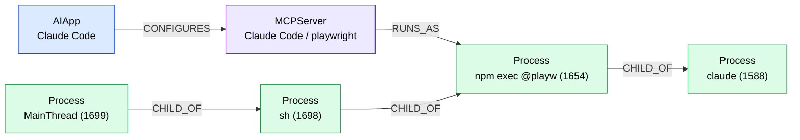

# mcpgraph

A single-binary, read-only Go agent that answers one question about a developer laptop:

> Which AI apps are installed, which MCP servers do they use, and which processes, credentials and data sources can those servers reach?

## The problem

AI coding tools (Claude Desktop, Claude Code, Cursor, VS Code) now launch
[MCP](https://modelcontextprotocol.io) servers: small programs that give the model tools like
"read files", "query Postgres" or "post to Slack". Each app keeps its own config file in its own
format and location, so on a typical laptop nobody has the full picture:

- API tokens are pasted in plain text into JSON config files that get synced and backed up.
- A filesystem server is given `~`, which includes `~/.ssh` and `~/.aws`, so one prompt injection can read them.
- `npx -y some-mcp-server` downloads and runs the latest publish on every start.
- Some MCP processes run without being declared in any config at all.

`mcpgraph` finds the configs and the running processes, puts them in one graph, and runs risk
rules on that graph.

## Quick start

```sh
make build                     # or: go build ./cmd/...
./mcpgraph scan                # inventory + findings; exit code 2 if any finding is high
./mcpgraph report -f json      # findings only, for CI
./mcpgraph export -f mermaid   # graph as a Mermaid flowchart
./mcpgraphd                    # daemon: watch configs, store snapshots, API on 127.0.0.1:7878
```

Useful flags: `--home DIR` scans another home directory (for example a fixture directory),
`--no-processes` skips process discovery.

## Sample output

From the fixtures in `testdata/configs` (all secrets there are fake):

```text
$ mcpgraph scan --home /home/dev --no-processes
Host: devbox (linux/amd64)

AI APPS (4)
APP             SERVERS  CONFIG
Claude Desktop  3        /home/dev/.config/Claude/claude_desktop_config.json
Claude Code     2        /home/dev/.claude.json
Cursor          3        /home/dev/.cursor/mcp.json
VS Code         2        /home/dev/.config/Code/User/mcp.json

MCP SERVERS (10)
APP             SERVER           TRANSPORT  COMMAND / URL                                                 SECRETS  ACCESSES
Claude Code     sentry           http       https://mcp.sentry.dev/mcp                                    0        saas:mcp.sentry.dev, saas:sentry
Claude Code     slack            stdio      npx -y slack-mcp-server@1.2.0                                 1        saas:slack
Claude Desktop  filesystem       stdio      npx -y @modelcontextprotocol/server-filesystem ~              0        filesystem:/home/dev
Claude Desktop  github           stdio      npx -y @modelcontextprotocol/server-github                    1        saas:github
Claude Desktop  postgres         stdio      npx -y @modelcontextprotocol/server-postgres@0.6.2 postgres…  1        database:postgresql://db.internal:5432/prod
Cursor          git              stdio      uvx mcp-server-git --repository ~/code/project                1        filesystem:/home/dev/code/project
Cursor          local-http       http       http://localhost:3000/mcp                                     0        -
Cursor          remote-insecure  http       http://10.0.0.5:8080/mcp?api_key=****abcd                     1        saas:10.0.0.5
VS Code         custom           stdio      node /opt/tools/server.js --api-key ****FAKE                  3        -
VS Code         github-remote    http       https://api.githubcopilot.com/mcp/                            1        saas:api.githubcopilot.com, saas:github

FINDINGS: 7 high, 4 medium, 0 low

HIGH (7)
  [R1] Plaintext secret GITHUB_PERSONAL_ACCESS_TOKEN in Claude Desktop / github
       /home/dev/.config/Claude/claude_desktop_config.json#$.mcpServers.github.env.GITHUB_PERSONAL_ACCESS_TOKEN
       (known token prefix ghp_). Config files are synced, backed up and read by other tools; reference an
       environment variable or secret store instead.
  [R2] Claude Desktop / filesystem can access /home/dev
       The server is rooted at the home directory or /, so a prompt injection can read SSH keys, cloud
       credentials and browser data; scope it to the project directory.
  ...

MEDIUM (4)
  [R3] Cursor / git runs unpinned package mcp-server-git via uvx
       Without a version, every start fetches the latest release, so a compromised or typosquatted publish
       runs immediately; pin an exact version.
  [R4] Cursor / remote-insecure uses plain http:// to 10.0.0.5:8080
       Tool calls, results and any auth headers cross the network unencrypted and can be read or modified
       in transit; use https://.
```

Note the masked values (`****abcd`): secrets never reach the graph, the output or the database.

`mcpgraph export -f mermaid` on a real machine where Claude Code runs a Playwright MCP server
(trimmed):



## Architecture

```
Collectors (each its own goroutine)          Graph builder            Consumers
┌───────────────────┐                     ┌──────────────────┐     ┌──────────────┐
│ config collector  │──┐                  │ single writer:   │────▶│ rule engine  │──┐
│ process collector │──┼── chan Event ───▶│ owns the Graph,  │     └──────────────┘  ├─▶ CLI report
│ config watcher    │──┘                  │ dedupes nodes    │────▶┌──────────────┐  ├─▶ JSON / Mermaid
└───────────────────┘                     └──────────────────┘     │ SQLite store │──┘─▶ localhost API
                                                                   └──────────────┘
```

| Package | Role |
| --- | --- |
| `internal/model` | Node, Edge, Graph, Event, Finding types; stable node IDs |
| `internal/collector/config` | One parser per app, candidate paths, derivation of credentials and data sources |
| `internal/collector/process` | AI app processes, their children and MCP-like processes (gopsutil) |
| `internal/collector/watch` | fsnotify watcher that re-parses a config file after it changes |
| `internal/graph` | Single-writer builder, RUNS_AS linking, snapshot diff |
| `internal/redact` | Secret detection and masking |
| `internal/rules` | R1–R6, one file each |
| `internal/store` | SQLite snapshots (pure Go driver) |
| `internal/daemon` | Long-running pipeline: initial scan, watcher, periodic re-scan, diff, store |
| `internal/api` | Read-only HTTP API on 127.0.0.1 |
| `internal/report` | Inventory and findings tables, JSON, Mermaid |
| `internal/sink` | `Sink` interface for a future central server; only a no-op exists |

### Graph model

Nodes: `Host`, `AIApp`, `MCPServer`, `Process`, `Credential` (kind, key name and location; never the
value), `DataSource` (filesystem, database or SaaS).

Edges: `CONFIGURES` (AIApp→MCPServer), `RUNS_AS` (MCPServer→Process), `USES_SECRET`
(MCPServer→Credential), `ACCESSES` (MCPServer→DataSource), `CHILD_OF` (Process→Process).

### Rules

| ID | Detects | Severity |
| --- | --- | --- |
| R1 | Plaintext secret in an MCP server's env, args, headers or URL | high |
| R2 | Filesystem MCP server rooted at `$HOME` or `/` | high |
| R3 | Unpinned package runner (`npx -y pkg`, `uvx pkg`, `pkg@latest`) | medium |
| R4 | Remote MCP over plain `http://` to a non-loopback host | medium |
| R5 | Credential files (`~/.aws/credentials`, `~/.ssh/id_*`, `.env`, ...) inside a path an MCP server can access | high |
| R6 | MCP-like process not declared in any config (shadow server) | medium |

`scan` and `report` exit with code 2 when any finding is high, so they can gate a CI job.

## Design decisions

**Single writer.** Only the graph builder goroutine changes graph state. Collectors never touch the
graph; they send `Event`s over a channel. So the graph needs no mutex, and there is no lock ordering
to get wrong. Each event carries a `Source` (for example `config:/home/u/.cursor/mcp.json`), and a new
event from a source replaces everything that source sent before. This is how the watcher removes a
server that was deleted from a config without rebuilding the rest of the graph. Readers only get
finished graphs: the builder publishes a new `*Graph` that shares no memory with its own state
(`Graph.Snapshot()` is a deep copy), and the daemon swaps it in with an `atomic.Pointer`.

**Context everywhere.** There is one root `context.Context`, cancelled on Ctrl-C/SIGTERM. Collectors
run under `errgroup.WithContext`, so one failing component cancels the others, and every channel send
`select`s on `ctx.Done()` so nothing blocks forever after shutdown. Partial failures are not fatal:
a broken config file or an unreadable process table becomes a warning on the event, not an error.

**Collectors are interfaces.** `collector.Collector` is two methods (`Name`, `Collect`). Inside the
config collector, each app is a `parser` with `App()` and `Parse()`. To add an app, you add a parser
file, a line in `paths.go` and a fixture.

**Stable node IDs.** `ID = kind + ":" + sha256(stable key)[:12]`. The key is the config path plus
the JSON path for servers, the location for credentials, and pid plus start time for processes. The
same server has the same ID in every scan. That makes `graph.Diff` a simple comparison by ID, which
is what lets the daemon log "new MCP server "notion" added to Cursor config".

**Secrets are dropped at the edge.** The raw parsed config type (`serverConfig`) is unexported, so it
cannot leave the config package. The only code that reads raw values is in `derive.go`, and it passes
every string through `internal/redact` before building a node. Env values are not stored at all, only
their names. Because masking happens once, at collection time, every output (tables, JSON, Mermaid,
SQLite, API) is safe by construction. `internal/scan/leak_test.go` checks this: it runs the fixtures
through every output format, including the raw SQLite file, and fails if any fake secret appears.

**Localhost only, and read-only.** The API refuses any listen address except `127.0.0.1:<port>`
(`localhost` is rejected because a name can resolve elsewhere, and `:port` would mean all
interfaces). It also checks the `Host` header, so a web page using DNS rebinding cannot read it.
The routes use Go 1.22 method patterns (`GET /graph`), so other methods get 405 without extra code.
There are no CORS headers. mcpgraph makes no outbound connections.

**No cgo.** gopsutil and `modernc.org/sqlite` are pure Go, so `CGO_ENABLED=0` builds static binaries
for darwin/linux × amd64/arm64.

## API

`mcpgraphd` serves read-only JSON on `127.0.0.1:7878`:

| Route | Returns |
| --- | --- |
| `GET /graph` | the current graph |
| `GET /findings` | current findings, most severe first |
| `GET /snapshots?limit=N` | stored snapshots (newest first) with the changes recorded for each |

Snapshots live in `~/.local/share/mcpgraph/mcpgraph.db` (Linux, or `$XDG_DATA_HOME/mcpgraph`) or
`~/Library/Application Support/mcpgraph/mcpgraph.db` (macOS). A snapshot is stored only when
something changed, and the last 500 are kept.

## Development

```sh
make build    # CGO_ENABLED=0 go build ./cmd/...
make test     # go test -race ./... (falls back to no -race if no C compiler is installed)
make lint     # golangci-lint run
make scan     # go run ./cmd/mcpgraph scan
make release  # goreleaser build --snapshot --clean
```

Tests never read the real machine: they build a fake `$HOME` in `t.TempDir()` from
`testdata/configs`, and the process collector is tested through a fake `Lister`.

## Limitations

- **Config locations.** Only `~/.claude.json` (Claude Code on Linux) has been checked on a real
  machine. The other paths in `paths.go` are marked `TODO(verify)`.
- **Project-scoped configs** (`.mcp.json`, `.cursor/mcp.json`, `.vscode/mcp.json` inside repositories)
  are not scanned. Only user-level files are.
- **Servers that are not in a config file are invisible.** Examples are servers provided by Claude
  Code plugins or VS Code extensions. They show up only as R6 shadow processes while they run.
- **Heuristics.** Secret detection (prefixes, secret-named keys, entropy), data-source inference and
  process matching are heuristics. They can miss things or produce false positives. Process matching
  compares redacted arguments, so a server started by a wrapper script may not get a `RUNS_AS` edge.
- **Watching.** fsnotify watches the parent directory of each config file. A directory created after
  the daemon starts is picked up by the periodic full re-scan (default every minute), not instantly.
- **Version** of AI apps is not detected yet.
- **Process visibility.** Some fields of other users' processes need privileges, and mcpgraph never
  asks for more.

## Future work

- Detect what tools each server exposes (needs speaking MCP to it, which is no longer read-only).
- Project-scoped configs, found through the project list in `~/.claude.json` and recent workspaces.
- More apps (Windsurf, Zed, JetBrains, Continue), and Windows.
- eBPF / Endpoint Security based process and network tracing, to see what a server actually reads
  and where it connects, instead of what it is configured to reach.
- A real `Sink` that ships snapshots and findings to a central server for fleet-wide views.
- Signed releases and SBOMs from GoReleaser.
