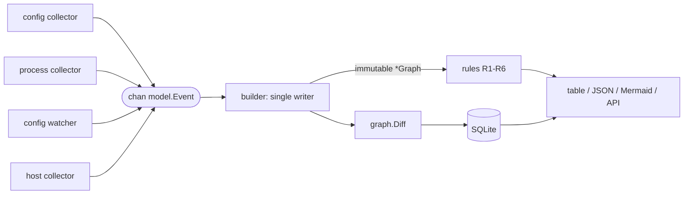

# Data pipeline

## One-shot scan (`mcpgraph scan`)

`scan.Run` starts each [collector](../components/index.md) in an `errgroup` goroutine. The
[builder](../components/graph-builder.md) runs in its own goroutine and reads the channel. When
`g.Wait()` returns, the orchestrator closes the channel, the builder publishes the final graph, and
the CLI evaluates the [rules](../rules/index.md).

## Daemon (`mcpgraphd`)

1. Initial scan: `scan.Collect` gathers every event, and the builder applies all of them before the
   first publish, so the first snapshot is complete.
2. Then three goroutines run under one errgroup:
   - the [watcher](../components/watcher.md), on config edits;
   - a ticker that re-runs the collectors, for processes and late-created config directories;
   - the builder loop.
3. Each publish runs the rules, then `graph.Diff` against the last snapshot. When something changed,
   it logs the changes and saves a snapshot ([store](../components/store.md)).

## Event replacement

Each `Event` has a `Source` such as `config:/home/u/.cursor/mcp.json`. A new event from the same
source replaces the old one entirely. That is how a deleted server disappears without a full
rebuild. A missing config file still produces an empty event, which clears what that file
contributed before.
